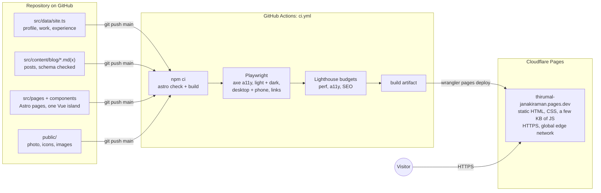

# How this site works

A static site. Astro turns Markdown, data files and components into plain HTML at build time. GitHub Actions tests it and publishes it to Cloudflare Pages. There is no server, no database and no running cost.

## Architecture



## How it is built

| Part | Tool | Why |
|---|---|---|
| Framework | Astro 7 | Pages render to HTML at build time and ship no JavaScript unless a component asks for it. |
| Content | Markdown and MDX in a typed content collection | A post is one file. The schema rejects a post without a title, date or description. |
| Profile data | `src/data/site.ts` | Copy lives apart from layout, so editing a line never touches markup. |
| Interactive part | One Vue component (the toolmarshal demo), hydrated only when it scrolls into view | Shows a real interaction without making the page heavy. |
| Styling | One CSS file with light and dark tokens | No CSS framework; the theme is a set of variables. |
| Feeds | RSS and sitemap generated at build | Readers and search engines pick up new posts automatically. |

## How it is checked

Every push and pull request runs `.github/workflows/ci.yml`:

1. `npm ci` from the lockfile.
2. `astro check` (types in pages, components and content) and the production build.
3. Playwright end to end tests on desktop Chrome and a phone profile: an axe accessibility scan of every page in light and dark mode, no sideways scroll, every post link answers 200, the demo and the theme toggle work.
4. Lighthouse over three runs per page: accessibility and SEO 100 and best practices 95 block the deploy; performance under 90 is a warning.
5. Only on `main`, and only if all of the above passed: the built `dist/` folder is deployed to Cloudflare Pages.

## How it is hosted

- Cloudflare Pages serves the files from Cloudflare's edge network over HTTPS, on the free plan.
- GitHub Actions deploys with `wrangler pages deploy`, using an API token scoped to Cloudflare Pages and the account ID, both stored as repository secrets. Cloudflare never builds the site itself, so nothing reaches visitors without passing the tests first.
- Lighthouse performance is reported as a warning: scores on shared CI runners swing too much to block a deploy. Accessibility, best practices and SEO still block.
- A custom domain can be added later in the Pages project; hosting stays free.

## Run it locally

```bash
npm ci
npm run dev     # http://localhost:4321
npm run build   # type check and build into dist/
npm test        # the same Playwright suite CI runs
```
